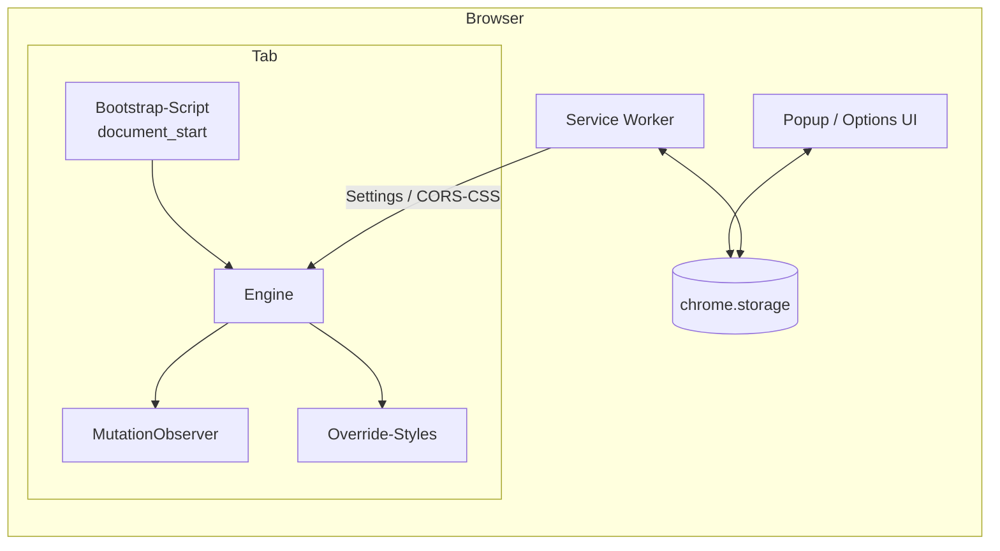

# Architekturentwurf

## Komponenten
| Komponente | Aufgabe |
|---|---|
| **Bootstrap** | Läuft bei `document_start`, setzt sofort `background:#000` (Anti-Weißblitz), liest Seitenregel aus Cache |
| **Engine** | Wählt [[Rendering-Modi\|Modus]], analysiert Styles, erzeugt Override-CSS nach [[Farbalgorithmus]] |
| **Observer** | Reagiert auf neue Knoten, Stylesheets, Attribut-/Klassenänderungen (gebündelt per `requestAnimationFrame`) |
| **Service Worker** | Einstellungen verteilen, Tastenkürzel, Icon-Status, Cross-Origin-Stylesheets laden |
| **Popup** | An/Aus global & pro Seite, Modus, Schnellregler (Textgrau, Bild-Dimmen) |
| **Options** | Seitenlisten, Einbrennschutz, Experteneinstellungen, Import/Export |
| **Site-Fixes** | Daten-Datei (JSON) mit Selektoren/CSS je Domain, im Paket ausgeliefert |

## Technologie-Vorschlag
- **TypeScript** + **Vite** (bzw. CRXJS/WXT als Extension-Build-Tooling)
- Popup/Options: schlank (Vanilla oder Preact) – die Erweiterung soll leicht bleiben
- Tests: **Vitest** für Farblogik, **Playwright** mit geladener Extension für Screenshot-Vergleiche auf Testseiten

> [!question] Noch offen
> Framework-Wahl fürs UI und Build-Tool → [[Offene Fragen]]

## Verwandt
[[Chrome Manifest V3]] · [[Farbalgorithmus]] · [[Rendering-Modi]]
